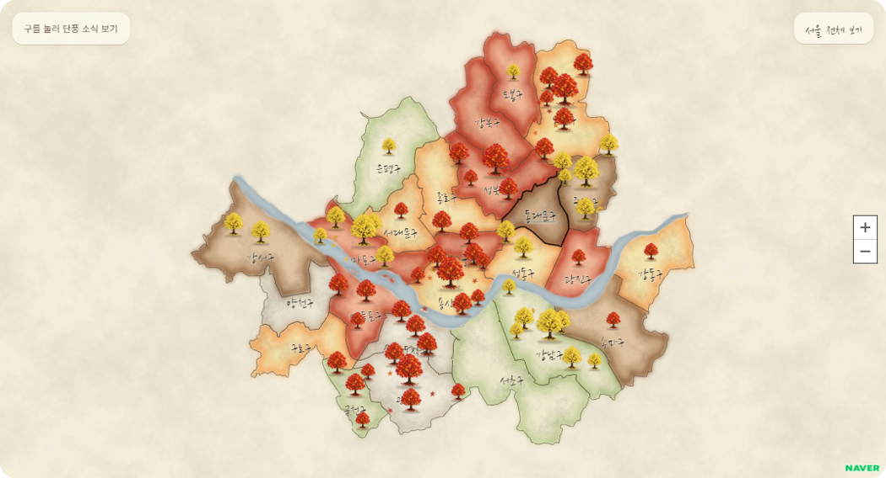
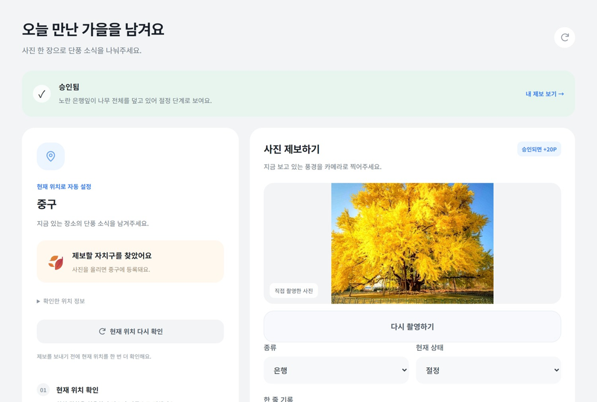

# 🍁 까우룽까우룽 (kauroong)

> **산림청 예측과 사용자 현장 제보로 보는 서울 25개 구 단풍 지도**

단풍 예측은 있지만, "지금 우리 동네가 얼마나 물들었는지"는 알기 어렵습니다.
까우룽까우룽은 산림청 절정 예측을 기본값으로 깔고, 사용자가 현장에서 직접 찍어 올린 사진 제보 중 **검증을 통과한 것만** 반영해 서울 25개 구의 단풍 상태를 지도로 보여주는 시즌제 서비스입니다.

네이버 클라우드 플랫폼(NCP) 수업에서 배운 네트워크, 서버 운영 자동화, 스토리지, 고가용성·확장성, 클라우드 DB 기술을 하나의 서비스로 엮어 만든 팀 프로젝트입니다.



---

## 목차
- [왜 만들었나](#왜-만들었나)
- [주요 기능](#주요-기능)
- [믿을 수 있는 제보를 위한 설계](#믿을-수-있는-제보를-위한-설계)
- [데이터 정책](#데이터-정책)
- [아키텍처](#아키텍처)
- [부하 테스트](#부하-테스트)
- [기술 스택](#기술-스택)
- [로컬 실행](#로컬-실행)
- [다음 단계](#다음-단계)
- [팀](#팀)

---

## 왜 만들었나

| 문제 | 설명 |
|---|---|
| 예측은 넓고, 우리 동네는 모른다 | 산림청 예측은 산지·수종 단위의 절정 시기를 알려 주지만, 지금 우리 구의 상태는 알 수 없습니다. |
| 현장 사진은 흩어져 있다 | 후기와 사진이 SNS·지도 앱에 흩어져 있고, 언제 어디서 찍었는지 믿기 어렵습니다. |
| 절정은 짧다 | 물들고 지는 시기가 짧아, 가기 전에 지금 상태를 확인할 수단이 필요합니다. |

**그래서 산림청 예측 위에, 검증된 사용자의 현장 제보를 올립니다.**

### 기존 서비스와의 차이

| 항목 | 산림청 예측지도 | 카카오맵 단풍 지도 | **까우룽까우룽** |
|---|---|---|---|
| 보여주는 단위 | 산지·수종별 절정 시기 | 전국 명소 65곳, 3단계 상태 | **서울 25개 구 단계 + 관심도** |
| 반영 데이터 | 관측 기반 예측 | 명소별 단풍 현황 | **산림청 예측 + 승인된 사용자 제보** |
| 사용자 참여 | 확인되지 않음 | 장소 후기, 후기 이벤트 | **직접 촬영 제보, 승인 시 포인트** |
| 사진 검증 | 확인되지 않음 | 확인되지 않음 | **위치 검증 · AI 판별** |

---

## 주요 기능

### 🗺️ 지도
- 동양풍 수채화 일러스트 스타일의 서울 25개 구 지도
- **구 색 = 단풍 단계**, **나무 크기·숲 밀도 = 관심도**
- 구를 누르면 하단 시트에서 **대표 명소**와 **사용자 게시물**을 탭으로 확인
- 명소를 누르면 해당 위치로 확대

### 📸 제보



- 현재 위치로 구가 자동 설정되고, 갤러리가 아닌 **카메라로 직접 촬영**한 사진만 제출
- 나무 종류와 단풍 단계를 고른 뒤 제출 → 검증 후 승인되면 **20포인트** 적립

### 📰 피드
- 승인된 제보를 최신순으로 보여주고, 구별로 필터링
- 반응은 **좋아요만**, 한 사람이 게시물마다 한 번만 반영

### 🌳 나만의 나무
- 제보로 모은 포인트로 나만의 나무를 꾸미기
- 나무 4종, 누적 포인트에 따른 성장 단계, 슬롯별 꾸미기 아이템

---

## 믿을 수 있는 제보를 위한 설계

마음먹고 속이는 사람을 100% 막을 수는 없으므로, 목표는 **속이는 데 드는 비용을 올리는 것**입니다.

- **직접 촬영만 허용**: 브라우저 카메라로 찍은 사진만 업로드
- **위치 검증**: 촬영 시점의 위치가 해당 구 경계 안일 때만 제출
- **서버 시각 기록**: 제보 시각은 기기 시각이 아닌 서버 수신 시각
- **쿨타임**: 같은 사용자의 연속 제보 제한
- **AI 판별**: CLOVA Studio(HCX-005)로 사진 속 단풍 여부와 단계를 판별 → 승인 / 운영자 검토 / 반려
- **개인정보 보호**: 저장 전 사진의 EXIF·GPS 정보 제거, 사진은 비공개 저장
- **중복 방지**: Idempotency-Key로 같은 요청의 중복 처리 방지, 포인트·좋아요 중복 반영 방지

---

## 데이터 정책

**단풍 단계 결정**
- 최근 3일 승인 제보가 3건 이상이면 → 제보 **다수결**
- 부족하면 → **산림청 예측 절정일** 기준으로 계산

**관심도 (나무 크기)**
```
관심도 점수 = 승인 제보 수 × 2 + 제보자 수 × 3 + 좋아요 수   (최근 7일)
→ 레벨 0 ~ 3
```

- 구별 단계와 관심도는 **1분 주기**로 다시 집계
- 피드는 제보가 승인되는 즉시 반영

---

## 아키텍처

```
                    인터넷
                      │
        ┌─────────────┴──────────────── VPC ───────────────────────┐
        │  Public subnet    Load Balancer · NAT Gateway             │
        │                       │                                   │
        │  Private subnet   API 서버 (FastAPI, Auto Scaling)         │
        │  (API)            검증·집계 워커 ──(NAT)──▶ CLOVA Studio   │
        │                       │                                   │
        │  Private subnet   Cloud DB for MySQL                      │
        │  (DB)                                                     │
        └───────────────────────────────────────────────────────────┘
                      │
                Object Storage (제보 사진 비공개 저장)
```

### 사용한 NCP 서비스

| 영역 | 우리 서비스에서 | NCP 서비스 |
|---|---|---|
| 네트워크 | API와 DB는 Private 서브넷으로 분리, API 진입은 LB | VPC · Subnet · NAT Gateway · ACG |
| 서버·운영 자동화 | 서버 이미지로 API 서버를 복제하고 Auto Scaling으로 관리 | Server · Auto Scaling |
| 스토리지 | 제보 사진 비공개 저장 | Object Storage |
| 고가용성·확장성 | LB 뒤에서 API 서버를 여러 존(KR-1·KR-2)에 분산 | Load Balancer · Auto Scaling |
| 데이터베이스 | 제보·작업 큐·집계·포인트 저장 | Cloud DB for MySQL |
| AI | 사진 속 단풍 여부와 단계 판별 | CLOVA Studio |
| 모니터링 | 서버 CPU·메모리 확인 | Cloud Insight |

### 제보 처리 파이프라인

접수와 검증을 분리해서, AI 검증이 느려도 사용자는 기다리지 않습니다.

```
사진 제보 ─▶ API: 사진 저장 후 202 즉시 응답 ─▶ DB 작업 큐
                                                │
                     워커: CLOVA Studio로 검증 ◀─┘
                       ├─ 승인  → 피드 공개 + 20포인트 + 다음 집계 때 지도 반영
                       ├─ 검토  → 운영자 확인
                       └─ 반려
```

- 작업 임대 토큰으로 늦게 도착한 검증 결과가 최신 결과를 덮어쓰지 못하게 처리
- 검증이 3회 실패하면 운영자 검토로 전환
- CLOVA 비용 관리: 동시 호출 2개 제한, 출력 토큰 200 제한, 제보별 토큰 사용량 기록

---

## 부하 테스트

[k6](https://k6.io/)로 사진 제보와 피드 조회를 구간별로 늘려 가며 로드밸런서 뒤의 API 서버를 테스트했습니다.

### 시나리오

| 구간 | 시간 | 사진 제보 | 피드 조회 |
|---|---|---|---|
| 기준 | 1분 | 1건/s | 2건/s |
| 준비 | 2분 | 2건/s | 10건/s |
| 증가 | 3분 20초 | 5건/s | 25건/s |
| 압박 | 4분 30초 | 10건/s | 50건/s |
| 회복 관찰 | 5분 | — | 5건/s |

- 테스트 계정 120개로 분산해 계정별 쿨타임(429)이 서버 병목처럼 보이지 않게 설계
- 실제 JPEG 6장을 번갈아 업로드, 자동 재시도 없음
- 테스트 중에는 AI 검증을 demo 모드로 전환해 CLOVA 비용 차단

### 결과 (API 서버 3대 구성)

| 지표 | 결과 |
|---|---|
| 완료 | **25,327건** (16분 35초, 구간별 목표 속도 달성) |
| 실패율 | **0%** (중단 0건) |
| 최대 처리량 | 초당 약 **60건** (제보 10 + 피드 50) |
| 응답 시간 p95 | 대부분 약 **50~100ms**, 압박 구간 끝에 약 200ms까지 일시 상승 후 회복 |
| 서버 CPU | Cloud Insight 그룹 평균 최고 약 **15%**, 메모리 약 6% |

이 부하에서는 3대가 CPU 여유를 크게 남긴 채 안정적으로 처리했습니다.
테스트 중 워커가 집계 옵션 없이 실행돼 지도가 갱신되지 않던 문제를 발견해 수정했습니다.

---

## 기술 스택

| 구분 | 사용 기술 |
|---|---|
| Frontend | React, Vite, NAVER Maps API |
| Backend | Python, FastAPI, SQLAlchemy, Alembic |
| Database | MySQL (Cloud DB for MySQL), 로컬 개발은 SQLite |
| AI | CLOVA Studio (HCX-005) |
| Infra | NAVER Cloud Platform (VPC, Server, Auto Scaling, Load Balancer, Object Storage, Cloud DB, Cloud Insight) |
| Test | pytest, Ruff, k6 |

---

## 로컬 실행

**요구 사항**: Python 3.12, Node.js 24, pnpm 11

```bash
python3.12 -m venv .venv
.venv/bin/python -m pip install -r backend/requirements-dev.txt
cd frontend && pnpm install --frozen-lockfile && cd ..
./scripts/dev.sh        # Windows: scripts/dev.ps1
```

`.env`는 없어도 로컬 기본값으로 실행됩니다. 설정을 바꾸려면 `.env.example`을 `.env`로 복사하세요. CLOVA 키 등 비밀값은 커밋하지 마세요.

- 웹: http://127.0.0.1:5173
- API 문서: http://127.0.0.1:8000/docs

> 카메라·위치 기능은 브라우저 보안 정책상 HTTPS 또는 localhost에서만 동작합니다.

### 테스트

```bash
.venv/bin/pytest -q
.venv/bin/ruff check backend cloud_function scripts/package_function.py
cd frontend && pnpm build
```

자세한 개발·배포·부하 테스트 방법은 [개발 가이드](docs/development.md), [NCP 배포 가이드](docs/ncp-deployment.md), [부하 테스트 가이드](docs/load-test.md), [API 명세](docs/api.md)를 참고하세요.

---

## 다음 단계

- 웹을 Object Storage·CDN 정적 배포로 이전
- 서버 1대의 처리 한계를 측정해 증설 기준 산정
- 1분 집계를 Cloud Functions로 이관
- 은행·벚꽃 등 시즌별 지도 확장, 신고 기능

---

## 팀

| 이름 | 소속 |
|---|---|
| 김재형 | 경희대학교 컴퓨터공학과 |
| 이석현 | 경희대학교 소프트웨어공학과 |
| 이정원 | 경희대학교 인공지능학과 |
| 최은호 | 경희대학교 컴퓨터공학과 |

네이버 클라우드 플랫폼 교육 과정 팀 프로젝트 (2026)

## 데이터 출처
- 산림청 2026 단풍 절정 예측 (2026.9.22 발표)
- 서울시 자치구 경계 데이터 (SGIS)
- 한강 수면 데이터 © OpenStreetMap contributors (ODbL)
