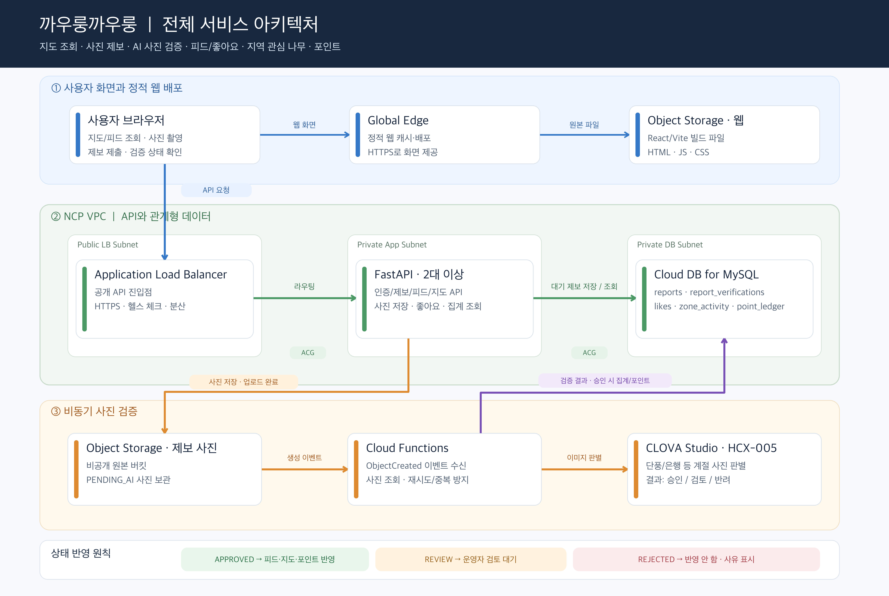

# 까우룽까우룽 전체 아키텍처

## 서비스 경로

- **화면:** 브라우저 → Global Edge → 정적 웹 전용 Object Storage 버킷
- **API:** 브라우저 → 공개 Application Load Balancer → Private App Subnet의 FastAPI 서버(2대 이상)
- **데이터:** FastAPI → Private DB Subnet의 Cloud DB for MySQL. DB는 인터넷에 직접 노출하지 않는다.
- **사진:** 제보 사진은 정적 웹 버킷과 분리된 비공개 Object Storage 버킷에 저장한다. 승인된 사진의 조회 URL만 API가 제한된 시간 동안 발급한다.

## 제보와 사진 검증 순서

1. `POST /reports`가 로그인, 위치·구역, 이미지 형식·크기, 제보 빈도 등을 검사하고 `reports.status=PENDING_UPLOAD` 및 고유 `photo_object_key`를 먼저 DB에 저장한다.
2. FastAPI가 비공개 사진 버킷에 업로드한다. 업로드가 끝나면 조건부 갱신으로 `PENDING_UPLOAD` 상태만 `PENDING_AI`로 바꾸고, 브라우저에 `202 Accepted`, `report_id`, 현재 상태를 반환한다. 업로드 실패 시 아직 `PENDING_UPLOAD`인 제보만 `UPLOAD_FAILED`로 표시한다.
3. Object Storage의 `ObjectCreated` 이벤트가 Cloud Functions를 실행한다. 함수는 사진과 DB의 제보 행을 확인한다. 이벤트가 2번의 상태 갱신보다 먼저 오더라도 `PENDING_UPLOAD` 또는 `PENDING_AI`를 처리할 수 있어야 한다. 이후 CLOVA Studio `HCX-005`에 사진을 보내 단풍/은행 사진 적합성을 판별한다. 사진은 비공개로 유지하고 함수가 읽은 이미지를 모델에 전달한다.
4. 함수가 모델 응답과 판별 사유를 `report_verifications`에 기록하고, 정책에 따라 `APPROVED`, `REVIEW`, `REJECTED` 중 하나를 결정한다. 오류·응답 파싱 실패·애매한 결과는 `REVIEW` 또는 재시도 대상으로 둔다.
5. `APPROVED`로 바뀌는 첫 순간에만 `point_ledger` 적립과 지역 집계 갱신을 수행한다. 피드와 지도 조회는 `APPROVED` 제보만 반환한다. 운영자는 `REVIEW` 제보를 승인하거나 반려할 수 있다.
6. 브라우저는 `GET /reports/{id}/status`로 결과를 확인하고, 승인·검토·반려 상태와 사유를 보여준다.

## DB 반영 규칙

- `reports`: `id`, `user_id`, `zone_id`, `photo_object_key`, `status`, `created_at`, `approved_at`, `like_count` 등을 보관한다.
- `report_verifications`: `report_id`, `model_name`, `model_version`, `result`, `reason`, `raw_response_ref`, `verified_at`, `reviewer_id`, `reviewed_at` 등을 보관한다. 민감한 원본 응답은 필요한 범위와 보존 기간을 정한다.
- `report_likes`: `(report_id, user_id)` 유니크 제약으로 중복 좋아요를 막는다. 승인된 제보에만 좋아요를 허용한다.
- `zone_status`: 승인된 최신 제보를 바탕으로 단풍 상태를 요약한다.
- `zone_activity`: 승인된 제보 수, 서로 다른 제보자 수, 좋아요 수 등을 집계해 지도 위 관심 나무의 단계에 사용한다.
- `point_ledger`: 적립 사유별 `dedupe_key` 유니크 제약으로 재처리 시 이중 적립을 막는다. 개인 나무·아이템은 기존 사용자 포인트 및 보유 아이템 데이터에서 계산한다.

## 운영 기준

- 검증 함수는 같은 Object Storage 이벤트가 다시 전달되어도 결과가 한 번만 반영되도록 조건부 상태 변경과 유니크 키를 사용한다.
- 오래 `PENDING_UPLOAD` 또는 `PENDING_AI`에 머문 제보를 찾는 재처리 작업을 둔다.
- FastAPI와 Cloud Functions의 DB 접근은 VPC 연결과 ACG로 제한한다. 함수에서 CLOVA Studio API 호출이 가능한 경로는 배포 환경에서 확인하고, 필요한 경우 NAT Gateway를 구성한다.
- AI는 사진 속 대상의 적합성만 보조 판단한다. 촬영 시각·장소의 진위는 AI 결과만으로 확정하지 않는다.

## 참고 문서

- [NCP Object Storage 이벤트와 Cloud Functions](https://guide.ncloud-docs.com/docs/en/objectstorage-use-bucket)
- [Cloud Functions의 VPC 연결](https://guide.ncloud-docs.com/docs/en/cloudfunctions-actioncreate-vpc)
- [CLOVA Studio 모델](https://guide.ncloud-docs.com/docs/clovastudio-model)
- [CLOVA Studio Chat Completions V3 이미지 입력](https://api.ncloud-docs.com/docs/en/clovastudio-chatcompletionsv3)
